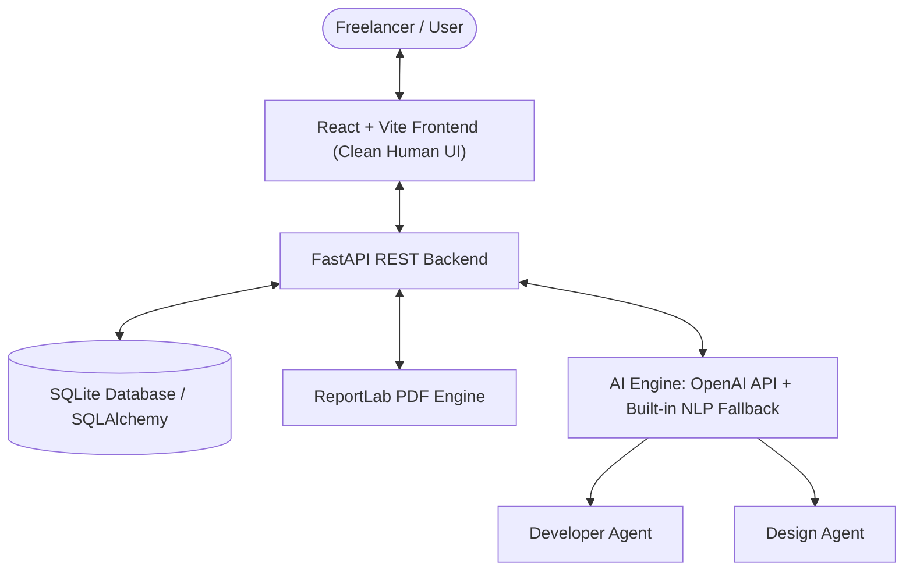

# TaskMate AI: An Intelligent Personal Assistant for Freelancers

**Course / Submission:** SEML (Software Engineering & Modeling / Machine Learning) Mini-Project  
**Institution:** Pimpri - Chinchwad College of Engineering, Pune  
**Team Members:**
- Maahit Bhavsar (124B1F154)
- Pranav Shirode (124B1F156)
- Yashodhan Suryawanshi (125B2F004)

---

## 🌟 Overview & Product Objectives
TaskMate AI is an end-to-end intelligent web platform designed to eliminate repetitive administrative overhead for independent freelancers and micro-agencies. Developed in strict accordance with the project's **IEEE Software Requirements Specification (SRS)** and architectural models, it incorporates:

1. **User Authentication & Profiles (FR-1 – FR-5):** Secure password hashing, session management, and custom hourly rate/skills configuration.
2. **AI Client Management CRM (FR-9 – FR-16):** Lead, Active, and Completed client pipelines, search/filters, and AI-powered follow-up recommendations.
3. **AI Requirement Analyzer (FR-17 – FR-25):** Unstructured text and document parser (.pdf, .docx, .txt) that automatically extracts Scope, Deliverables checklist, Estimated Budget range, Timeline, and Tech Stack.
4. **Proposal, Quotation & Invoice Engine (FR-26 – FR-33):** Multi-template AI proposal generation, editable rich Markdown preview, itemized invoices, and **1-click ReportLab PDF export**.
5. **Multi-Agent Task Orchestrator (Sequence & State Diagrams):** Autonomous multi-agent pipeline routing tasks to **Developer Agent** (APIs, code scaffolding, automated tests) and **Design Agent** (tokens, layout wireframes, design systems) with client revision loops (`Drafting` → `Queued` → `Processing` → `Reviewing` → `Completed` / `Reworking`).
6. **Smart Scheduler & Calendar (FR-42 – FR-49):** Meetings, milestones, and deadline visualization, automatic conflict warning detection, and Google Calendar sync simulation.
7. **Outreach & Communication Automation (FR-34 – FR-41):** AI message generator for Email and WhatsApp with customizable tone and scheduling.
8. **Business Analytics Dashboard:** Real-time revenue tracking, expense logs, proposal win rates, and client distribution charts.

---

## 🎨 UI/UX Design Philosophy
In compliance with user preferences, the application features a **clean, human-centric design**:
- No futuristic/neon clutter or distracting gimmicks.
- Predictable sidebar navigation, high-contrast readable typography (system UI/Inter), soft neutral slate palette, and clear semantic status indicators.
- Non-destructive modals and confirmation prompts adhering to IEEE safety requirements.

---

## 🚀 Quick Start Guide

### Prerequisites
- Python 3.10+
- Node.js 18+ and npm

### 1-Click Launch (Recommended)
Run the root launcher to start both the FastAPI backend and React frontend concurrently:
```bash
python run_app.py
```

### Accessing the Platform
- **Frontend Web App:** [http://127.0.0.1:5173](http://127.0.0.1:5173)
- **Interactive Backend API Docs (Swagger UI):** [http://127.0.0.1:8000/docs](http://127.0.0.1:8000/docs)

### Pre-configured Demo Account
The database is automatically pre-seeded with realistic clients, proposals, and tasks for immediate demonstration.
- **Email:** `yashodhan@taskmate.ai`
- **Password:** `freelance123`
*(Or simply click the **"One-Click Demo Sign In"** button on the login screen).*

---

## 🛠️ System Architecture & Tech Stack



- **Frontend:** React 19, Vite, Lucide Icons, Clean Vanilla CSS.
- **Backend:** Python FastAPI, Uvicorn, SQLAlchemy, Pydantic v2.
- **PDF Generation:** Python ReportLab.
- **AI / NLP Service:** Dynamic OpenAI API integration (`gpt-4o-mini`) with intelligent built-in fallback NLP parser for zero-setup offline operation.
