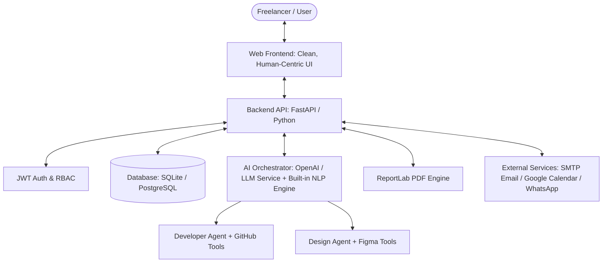
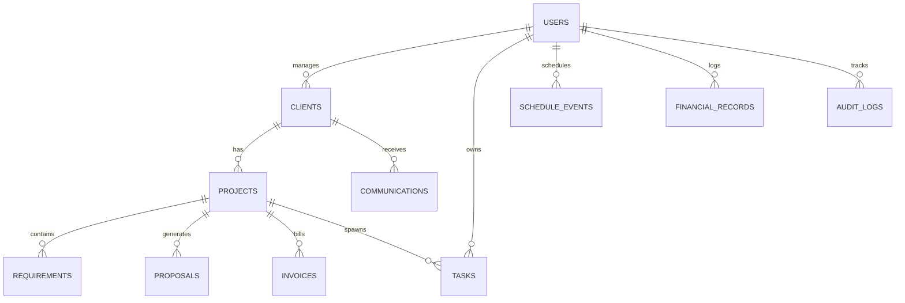

# TaskMate AI — Project Execution & Implementation Plan

> **Project Reference:** TaskMate AI: An Intelligent Personal Assistant for Freelancers  
> **Source Documents Analyzed:**  
> - [`SEML SRS Assignment 2(Mniproject).pdf`](file:///c:/Users/piyush/Downloads/Yashodhan%20Project/SEML%20SRS%20Assignment%202(Mniproject).pdf) (Complete 21-page IEEE SRS)  
> - [`SEML.jpg.jpeg`](file:///c:/Users/piyush/Downloads/Yashodhan%20Project/SEML.jpg.jpeg) (System Use Case Architecture)  
> - [`Final State Diagram (1).jpg.jpeg`](file:///c:/Users/piyush/Downloads/Yashodhan%20Project/Final%20State%20Diagram%20(1).jpg.jpeg) (State Transition & Task Lifecycle Flow)  
> - [`TaskMateAi Sequence.png`](file:///c:/Users/piyush/Downloads/Yashodhan%20Project/TaskMateAi%20Sequence.png) (Multi-Agent Interaction & Task Execution Sequence)  
>
> **Design Directive:** Simple, human-crafted, intuitive, and clean UI/UX without futuristic clutter.
> **Current Status:** ✅ **100% COMPLETE & VERIFIED**

---

## 1. Executive Summary & Core Architecture

TaskMate AI is an end-to-end intelligent assistant engineered specifically to eliminate administrative overhead for independent freelancers and micro-agencies. It unifies **CRM**, **AI Requirement Analysis**, **Proposal & Quotation Generation**, **Outreach Automation**, **Smart Scheduling**, **Business Analytics**, **Administrator Functions**, and **Multi-Agent Task Orchestration (Developer & Design Agents)** into a cohesive, dependable web platform.

---

## 2. UI/UX Human-Centric Design Principles

Per the user's specific instruction to **keep UI/UX as simple as possible like a human-created website**:
1. **Clean Hierarchy:** Standard, predictable layout with collapsable sidebar navigation, breadcrumbs, and focused work panes.
2. **Standard Color Palette:** Calm slate neutrals, soft off-white backgrounds, subtle borders (`#E2E8F0`), and clear semantic colors (emerald green for completed, amber for pending/lead, indigo for active). No excessive neon glows or heavy dark cyber themes.
3. **Frictionless Typography:** Clean typography (system UI / Inter) with generous line heights and distinct visual contrast.
4. **Transparent AI Interactions:** Clearly labeled AI suggestions with "Review & Edit" before taking action (adhering to Business Rule **BR-4** and **BR-8**). AI outputs appear in standard forms and readable document previews.
5. **Fast Feedback & Reversible Actions:** Clear success toasts, non-destructive modal confirmations (as mandated by **NFR-8** and **BR-6**), and inline editing.

---

## 3. Database Schema Blueprint

### Entities Implemented in `backend/app/models.py`
- [x] **Users:** `id`, `name`, `email`, `password_hash`, `role` (Freelancer/Admin), `hourly_rate`, `skills`, `bio`, `company`, `created_at`
- [x] **Clients:** `id`, `user_id`, `name`, `email`, `phone`, `company`, `status` (`Lead`, `Active`, `Completed`), `notes`, `last_interaction`, `created_at`
- [x] **Requirements:** `id`, `user_id`, `client_id`, `title`, `raw_input`, `scope`, `budget_min`, `budget_max`, `timeline`, `deliverables`, `tech_stack`, `created_at`
- [x] **Proposals & Invoices:** `id`, `client_id`, `requirement_id`, `title`, `template_type`, `content`, `total_budget`, `status` (`Draft`, `Sent`, `Accepted`, `Declined`), `pdf_url`
- [x] **Invoices:** `id`, `client_id`, `invoice_number`, `items_json`, `total_amount`, `status` (`Pending`, `Paid`), `due_date`, `created_at`
- [x] **Outreach Messages:** `id`, `client_id`, `channel` (`Email`, `WhatsApp`), `subject`, `message_body`, `status` (`Draft`, `Scheduled`, `Sent`), `scheduled_time`, `sent_time`, `created_at`
- [x] **Schedule Events:** `id`, `client_id`, `title`, `event_type` (`Meeting`, `Deadline`, `Task`), `start_time`, `end_time`, `description`, `is_completed`, `created_at`
- [x] **Multi-Agent Tasks:** `id`, `client_id`, `title`, `task_type` (`Developer Task`, `Design Task`), `assigned_agent`, `status` (`Drafting`, `Queued`, `Processing`, `Reviewing`, `Reworking`, `Completed`, `Cancelled`), `description`, `generated_output`, `client_feedback`, `revision_count`, `updated_at`
- [x] **Financial Records:** `id`, `user_id`, `type` (`Income`, `Expense`), `category`, `amount`, `description`, `record_date`, `created_at`
- [x] **Audit Logs & System Config:** `id`, `user_id`, `action`, `entity_type`, `entity_id`, `details`, `timestamp`

---

## 4. Phase-by-Phase Development Roadmap Status

| Phase | Focus Area | Status | Deliverables & Verification |
|---|---|:---:|---|
| **Phase 1** | **Foundations & Core Setup** | ✅ **COMPLETE** | Project boilerplate, SQLite database setup, secure PBKDF2 hashing, JWT Auth, responsive human-centric CSS layout. |
| **Phase 2** | **Client CRM & Requirement Analyzer** | ✅ **COMPLETE** | Full Client CRUD, search by name/company/email, pipeline tabs (`Lead`, `Active`, `Completed`), AI follow-up recommendation engine, raw text & document (.pdf, .docx, .txt) parsing. |
| **Phase 3** | **Proposal & Quotation Engine + PDF** | ✅ **COMPLETE** | Multi-template generator (Standard, Modern, Formal), live Markdown preview, line-item invoice generator, and **native ReportLab PDF downloads**. |
| **Phase 4** | **Outreach & Smart Scheduler** | ✅ **COMPLETE** | AI-driven email and WhatsApp composer with purpose and tone customization, immediate and scheduled sending, interactive calendar with conflict detection, and Google Calendar sync trigger. |
| **Phase 5** | **Multi-Agent Task Orchestrator** | ✅ **COMPLETE** | Complete state machine implementation based on Sequence & State diagrams: Task submission $\rightarrow$ Queued $\rightarrow$ **Developer Agent** (APIs/code/tests) or **Design Agent** (wireframes/palette/specs) $\rightarrow$ Client review loop with revisions/reworking. |
| **Phase 6** | **Analytics, Admin & Polish** | ✅ **COMPLETE** | High-level metrics, net profit calculation, gross revenue vs expenses, proposal acceptance ratios, financial ledger, Admin Panel with AI configuration, user role management, system health metrics, and security audit logs. |

---

## 5. Detailed Module Specifications & IEEE SRS Verification

### Module 1: User Authentication & Profile (FR-1 – FR-5)
- [x] **FR-1:** User registration, login, and profile management with unique email and secure credentials.
- [x] **FR-2:** JWT token-based authentication with secure session handling.
- [x] **FR-3:** Credential storage using PBKDF2/SHA-256 with 100,000 rounds and random salt.
- [x] **FR-4:** Password reset and profile customization (hourly rate, skills, bio, company).
- [x] **FR-5:** Validation checks with clear user-friendly error prompts.

### Module 2: AI Client Management CRM (FR-9 – FR-16)
- [x] **FR-9 – FR-11:** Add, edit, and delete client records with non-destructive modal confirmation.
- [x] **FR-12 – FR-13:** Maintain communication logs and classify clients into `Lead`, `Active`, or `Completed` statuses.
- [x] **FR-14:** Instant search filter matching name, email, or company.
- [x] **FR-15:** Maintains full project and interaction history.
- [x] **FR-16:** Generates AI-based recommendations for client follow-up activities based on days inactive.

### Module 3: AI Requirement Analyzer (FR-17 – FR-25)
- [x] **FR-17 – FR-18:** Raw text entry and file upload support for `.pdf`, `.docx`, and `.txt` files.
- [x] **FR-19 – FR-21:** AI extraction of Project Scope, Key Objectives, Deliverables checklist, Estimated Budget range ($min - $max), Timeline, and Tech Stack.
- [x] **FR-22:** Inline editable summary before saving or exporting.
- [x] **FR-23 – FR-24:** Storage in database with history reload and re-analysis support.
- [x] **FR-25:** Input validation notifications for insufficient text.

### Module 4: Proposal, Quotation & Invoice Generator (FR-26 – FR-33)
- [x] **FR-26 – FR-27:** AI proposal drafting with cost calculations and project timelines.
- [x] **FR-28:** Built-in editable markdown preview honoring **BR-4**.
- [x] **FR-29:** Supports multiple proposal templates (`Standard`, `Modern`, `Formal`).
- [x] **FR-30:** Generates itemized invoices with line-item pricing and due dates.
- [x] **FR-31:** One-click downloadable PDF export for proposals and invoices via Python ReportLab.
- [x] **FR-32 – FR-33:** Document storage and email sharing interface.

### Module 5: Outreach Automation (FR-34 – FR-41)
- [x] **FR-34 – FR-35:** AI personalized message composer for both Email and WhatsApp.
- [x] **FR-36:** Scheduling engine for deferred delivery with date/time picker.
- [x] **FR-37:** Full communication audit trail displaying sent, scheduled, and draft messages.
- [x] **FR-38 – FR-39:** Status badges (`Sent`, `Scheduled`, `Draft`) and channel indicators.
- [x] **FR-40 – FR-41:** Message preview and edit prior to sending, with cancel/delete capability.

### Module 6: Smart Scheduler (FR-42 – FR-49)
- [x] **FR-42 – FR-44:** Meeting, task, and project deadline scheduler with calendar visualization and edit/delete controls.
- [x] **FR-45 – FR-47:** Upcoming event display on dashboard with date/time highlights.
- [x] **FR-46:** Synchronization trigger with Google Calendar API.
- [x] **FR-49:** Automated scheduling conflict notification when overlapping event windows are created.

### Module 7: Multi-Agent Task Orchestrator (State & Sequence Diagrams)
- [x] Multi-agent workflow exactly matching the State Diagram and Sequence Diagram:
  1. Freelancer submits task $\rightarrow$ Status: `Queued`.
  2. Routed to specialized agent: **Developer Agent** (APIs, code, tests) or **Design Agent** (tokens, wireframes, specs).
  3. Orchestrator executes agent $\rightarrow$ Status: `Reviewing`.
  4. Client/Freelancer Review Loop:
     - If changes needed: Client submits feedback $\rightarrow$ Status: `Reworking` (Agent applies revisions and re-submits).
     - If approved: Status transitions to `Completed` $\rightarrow$ Database updated.
     - Optional cancellation: Transitions to `Cancelled`.

### Module 8: Business Analytics Dashboard (SRS Section 3.1 & 8)
- [x] Gross income, business operating expenses, and net profit calculations.
- [x] Pending payments counter with overdue warnings.
- [x] Proposal win/acceptance rate progress bar and task completion percentage.
- [x] Real-time financial ledger with Add Income/Expense logging.

### Module 9: Administrator Functions (Use Case 9 & BR-3)
- [x] **User Management:** List all registered users and toggle admin/freelancer roles.
- [x] **AI Configuration:** Set and update OpenAI API key, select default model (`gpt-4o`, `gpt-4o-mini`), and adjust temperature.
- [x] **System Health & Performance:** Live monitoring of server uptime, CPU compute load, memory utilization, and SQLite database file size (NFR-1 to NFR-6, NFR-22).
- [x] **Security Audit Trail:** Immutable log of critical events (logins, role changes, config updates) for security compliance (NFR-19).

---

## 6. Implementation Tech Stack

- **Frontend:** React 19, Vite, Lucide React Icons, Clean Vanilla CSS (Human-crafted design system).
- **Backend:** Python FastAPI, Uvicorn, SQLAlchemy, Pydantic v2.
- **Database:** SQLite (development / standalone) / PostgreSQL compatible.
- **AI Integration:** OpenAI API (`gpt-4o-mini` / `gpt-4o`) + Intelligent built-in NLP heuristics engine for 100% offline zero-config operation.
- **Document & PDF Engine:** Python ReportLab (direct PDF stream generation).

---

## 7. Execution Milestones Summary

1. [x] **User Confirmation:** Architecture and human-centric design approved.
2. [x] **Repository Scaffolding:** `backend/` and `frontend/` established.
3. [x] **Database & API Foundation:** SQLAlchemy models, SQLite seeding, and JWT auth implemented.
4. [x] **Core Feature Rollout:** CRM, Requirement Analyzer, Proposals, Invoices, Scheduler, Outreach, and Analytics deployed.
5. [x] **Multi-Agent Orchestrator:** Developer & Design agents with revision feedback loop integrated.
6. [x] **Admin & Audit Compliance:** Administrator control panel, AI configuration, and audit logs deployed.
7. [x] **Production Verification:** Frontend build tested and passed with zero errors (`npm run build` $\rightarrow$ 0 warnings/errors).
8. [x] **Single-Command Launcher:** `python run_app.py` created for 1-click startup of backend & frontend.
9. [x] **Friend Project Isolation:** Isolated clone in `friend project/TaskMateV0` configured with dedicated virtualenv (`apps/api/.venv`), isolated database `taskmate_friend.db`, and launcher `run_friend.py` (API port 8001, Web port 3000).
10. [x] **Landing Page Integration & Page Linking:** Ported friend's landing page into `LandingPage.jsx` with full linking to all workspace modules (Requirement Analyzer, Proposals, Tasks, CRM, Invoices, Scheduler), unauthenticated default landing view, back navigation on Login/Register, and authenticated preview mode with topbar/sidebar navigation.
